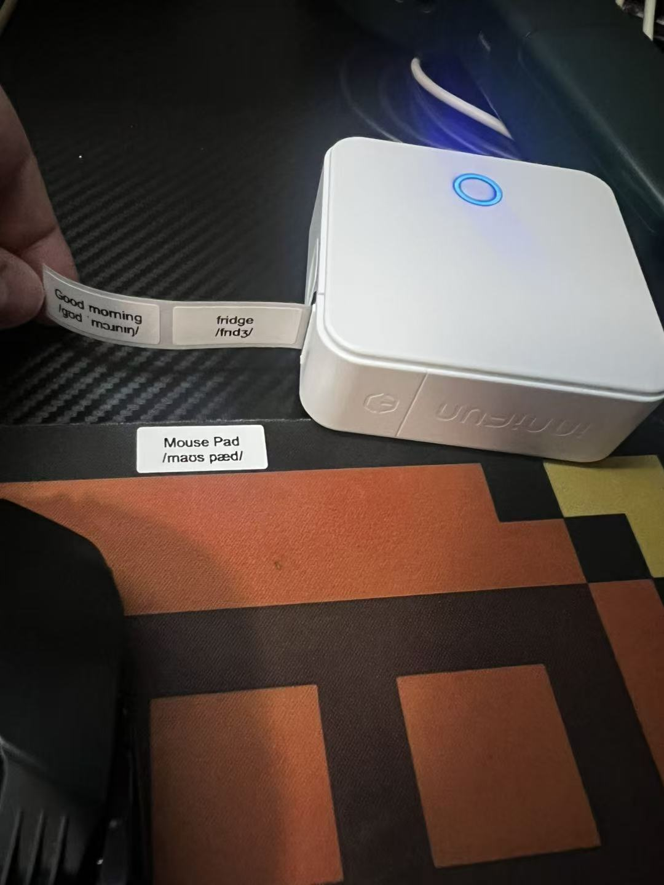
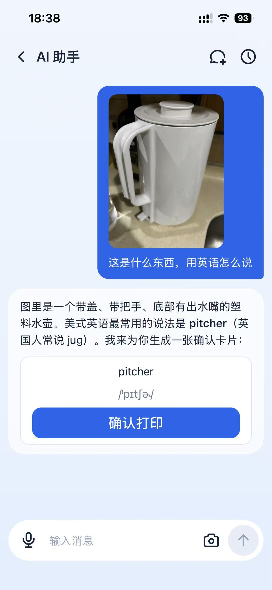
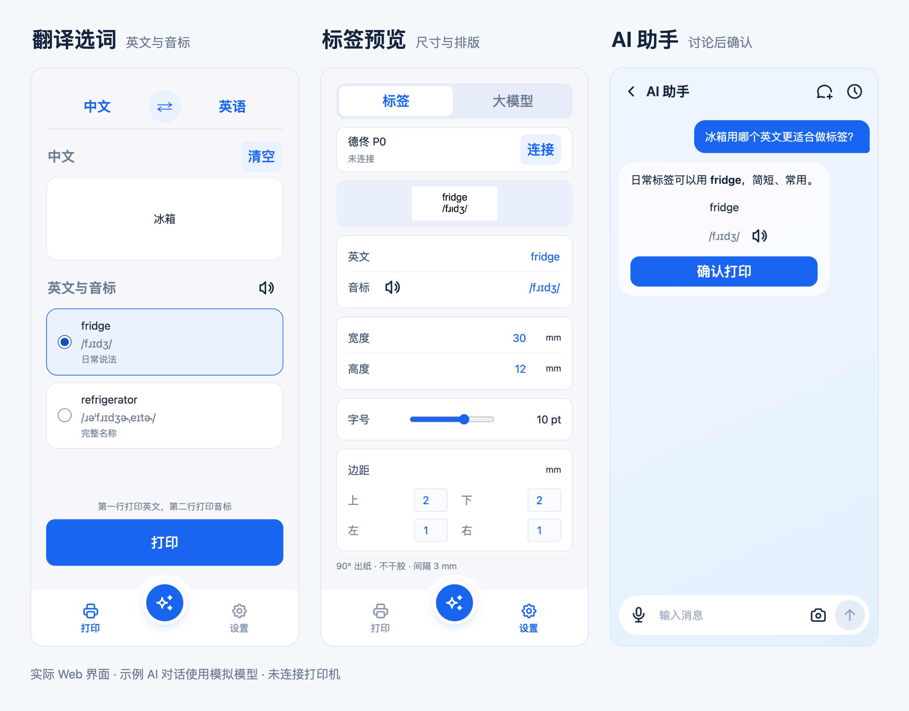
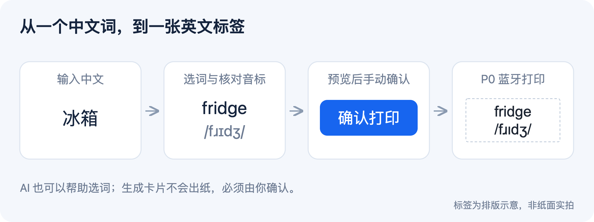

# 词签 · English Printer

**把日常物品变成英语学习标签：输入中文或英文，生成英文与音标，通过德佟 P0 蓝牙打印机打印。**

## 需要哪些设备

**德佟 P0 打印机 + 标签纸 + Mac 或 iPhone。** 实物打印需要下面这套设备：

| 设备 | 要求 |
| --- | --- |
| 打印机 | **德佟 P0 蓝牙标签打印机**，203 dpi、96 点打印头；其他型号尚未验证 |
| 标签纸 | 适用于 P0 的不干胶间隔标签纸，默认 **30 × 12 mm**，当前出纸设置使用 **3 mm 间隔** |
| 操作端（二选一） | **Mac**：运行本地服务，通过浏览器操作；**iPhone（iOS 17+）**：安装本项目 App，由手机直接连接打印机 |

iPhone App 首次构建安装仍需 **Mac、Xcode 和自己的开发者账号**，安装后可脱离 Mac 独立使用。目前没有 Windows 或 Android 客户端。没有打印机也可以体验选词和标签预览。

## 实际使用

下面是作者的实际使用记录：P0 打印英文与音标标签，以及在 iPhone 上上传物品照片，让 AI 帮助选词并生成待确认卡片。

### P0 与实际打印的标签



实物标签包含 Good morning、fridge 和 Mouse Pad，英文与音标各占一行。

### iPhone 照片识物与选词



上传照片询问英文表达，得到 pitcher 和音标，点击“确认打印”后才会下发。

[查看出纸原图](docs/images/p0-real-print.jpg) · [查看手机截图原图](docs/images/iphone-photo-to-label.jpg)

## 界面预览



*实际 Web 界面；AI 示例使用模拟模型，未连接打印机。可查看原图：[翻译选词](docs/images/translate.png) · [标签预览](docs/images/label-preview.png) · [AI 卡片](docs/images/ai-card.png)。*

给冰箱、杯子、书桌贴上英文，在日常生活中认词、听发音。标签上面一行英文，下面一行音标。

[产品官网](https://czm233.github.io/english-printer/) · [快速开始](#快速开始) · [配置与使用](docs/usage.md) · [iPhone 安装](ios/README.md) · [开发指南](docs/development.md)

## 能做什么

- **中英双向输入**：输入中文找英文，或输入英文核对中文；常用物品提供多种说法，只打印英文和音标。
- **音标与朗读**：使用本地 CMU 发音词典生成美式音标，支持英文朗读。主打印页遇到词典缺词会拦截，避免打印不完整音标。
- **标签排版**：预览两行标签，调整纸张尺寸、字号与边距；长词组可按完整单词拆分打印，保留连字符复合词。
- **AI 辅助选词**：通过文字、语音或照片讨论表达，生成待确认的打印卡片；支持流式回复、Markdown 和多轮对话。照片需要模型支持识图。
- **本地历史**：保存对话、照片、草稿与打印卡片状态，重启后可恢复；已确认的卡片不会因恢复历史而再次下发。

AI 只生成卡片，点击确认后才打印。“拆分打印”一次确认一整批，逐张等待设备完成；失败或结果不明确时立即停止，不自动补打。

## 从词语到标签

输入“冰箱”，选择合适的英文与音标，检查标签预览，再手动确认打印。AI 也可以帮助选词，最终都由你确认后交给 P0 出纸。



## Mac 与 iPhone 的区别

| | Mac 本地 Web | iPhone App |
| --- | --- | --- |
| 运行方式 | Node.js 本地服务 + 浏览器 | 打包 Web 界面 + Swift 原生桥接 |
| 打印连接 | Mac 通过 CoreBluetooth 连接 P0 | iPhone 直接连接 P0，不依赖 Mac 服务 |
| 通用翻译 | 百度通用文本翻译，需自行配置凭证 | MyMemory，需要网络 |
| 模型配置 | 本机 `.local/model-config.json` | 手机 Keychain，需单独配置 |
| 使用前提 | Node.js 22+；真实打印还需 Swift 和蓝牙权限 | iOS 17+；通过 Xcode 自行签名、构建安装 |

标签尺寸可配置宽 10–100 mm、高 6–12 mm，步进 0.5 mm。范围代表软件支持的参数，实际需与装入的标签纸匹配。

## 快速开始

### 在 Mac 上体验

准备 Node.js 22+，确认本机 `10290` 端口没有被其他项目占用：

```bash
git clone https://github.com/czm233/english-printer.git
cd english-printer
./scripts/preview.sh
```

打开 **[http://127.0.0.1:10290/](http://127.0.0.1:10290/)**。不需要 `npm install`、数据库或 Docker；终端保持运行，结束时按 `Ctrl+C`。

先把输入改为 **“冰箱”**，选择 **fridge**，在 **设置 → 标签** 查看预览。这条路径使用内置候选与本地音标词典，不需要翻译 Key、模型配置或打印机。页面启动本身不会连接设备或打印。

### 启用翻译、AI 与实物打印

| 要使用的能力 | 需要准备 |
| --- | --- |
| 翻译其他词句 | 在 `.local/baidu-translation.json` 配置自己的百度通用翻译 APP ID 与密钥，见[翻译配置](docs/usage.md#翻译与音标) |
| AI 助手 | 在 **设置 → 大模型** 填写 API URL、API Key 和模型 ID；服务须兼容 Anthropic Messages，见[模型配置](docs/usage.md#ai-助手) |
| 实物打印 | 开机的 P0、标签纸、Swift 开发环境、蓝牙权限和本机设备 UUID，见[连接与打印](docs/usage.md#连接自己的-p0) |

首次打印前，先断开手机微打或其他占用打印机的客户端。未连接时点击“打印”也会尝试连接设备并实际出纸。

### 在 iPhone 上使用

按 [iOS 构建与安装说明](ios/README.md#构建与安装)使用自己的开发者账号签名安装。手机直接处理蓝牙、模型请求和语音，无需让 Mac 服务一直运行；Mac 上的模型 Key 和聊天记录不会自动同步到手机。

## 使用前需要知道

- **联网与数据**：通用翻译和 AI 需要网络。翻译内容发送给相应翻译服务；发送给 AI 的消息、上下文与照片会传给你配置的模型服务。额度和费用取决于服务商。
- **模型兼容性**：使用 Anthropic Messages 协议；仅兼容 OpenAI Chat Completions 的接口不能直接使用。生成打印卡片还需要工具调用能力。
- **音标准确性**：AI 卡片优先使用本地词典；词典缺词时可能采用模型给出的音标，需要自行核对，不能视作词典校验通过。
- **打印结果**：“已打印”代表收到设备完成回执，纸面效果仍需检查；“已发送”或“结果未确认”时先看是否已出纸，避免重复打印。
- **验证范围**：已有 P0 实际出纸照片，以及 iPhone 照片识物、英文建议与待确认卡片的使用记录。Mac 与 P0 已有实机单张打印验证；iPhone 截图展示的是待确认状态，iOS 独立打印、语音与键盘交互，以及不同标签尺寸的纸面效果仍需逐项验收。

配置读取接口不返回已保存的 Key；Mac 配置存于已忽略的本机文件（0600，未加密），iOS 使用 Keychain。聊天历史各端独立保存在本机。详细存储位置与故障处理见[使用指南](docs/usage.md)。

## 开发与文档

| 入口 | 内容 |
| --- | --- |
| [使用指南](docs/usage.md) | 翻译与模型配置、打印机连接、历史与隐私、常见问题 |
| [开发指南](docs/development.md) | 项目结构、后台服务、模拟测试、诊断与模型基准测试 |
| [iOS 工程](ios/README.md) | 签名、Debug / Release 构建、安装、日志与符号归档 |
| [界面规范](DESIGN.md) | 全局字体、排版、音标和触摸行为 |
| [产品宣传页](docs/site.md) | 独立静态页面的本地预览与 GitHub Pages 部署 |

```text
web/      打印、聊天、设置界面与本地音标词典
server/   Mac 本地服务、翻译与模型代理、打印任务管理
printer/  Swift 蓝牙传输、标签栅格渲染与设备编码
ios/      iPhone 工程与原生桥接
tests/    协议、打印防重、历史及浏览器回归测试
docs/     使用与开发文档、截图、产品宣传页
```

自动化检查需要 macOS、Node.js 22+ 和 Swift；确认测试端口 `10291/10292` 空闲后运行：

```bash
mkdir -p work
node --test tests/*.test.mjs
```

测试使用模拟模型和设备，不调用付费接口、不真实打印。浏览器回归与后台验收服务用法见[开发指南](docs/development.md)。

## 产品宣传页

执行 `node scripts/site-acceptance.mjs up`，在 <http://127.0.0.1:10293/english-printer/> 查看独立宣传页；服务通过独立 tmux 会话保持运行，使用 `status` 检查、`down` 停止，不影响 10290 的 App。

GitHub Pages 工作流只打包首页、样式、交互脚本和明确列出的宣传图片，不发布 `docs/` 内的项目指南或文档截图。访问地址为 **[词签产品官网](https://czm233.github.io/english-printer/)**；后续宣传页更新在获准推送 `main` 后自动部署，部署说明见[产品宣传页文档](docs/site.md)。

## 反馈与贡献

通过 [GitHub Issues](https://github.com/czm233/english-printer/issues)反馈问题或建议，附上运行平台、复现步骤、预期与实际结果；不要附 API Key、私人聊天、照片或本机配置。修改前请阅读 [AGENTS.md](AGENTS.md) 和相关开发文档，界面修改还需遵守 [DESIGN.md](DESIGN.md)。

## 许可证与致谢

本项目采用 [MIT 许可证](LICENSE)，允许使用、修改、分发和商用，须保留版权与许可声明。

第三方组件仍遵循各自的许可证：本地发音词典、图标及浏览器依赖的许可分别见 [CMU](web/CMU-LICENSE.txt)、[CMUdict](web/CMUDICT-LICENSE.txt)、[Tabler Icons](web/icons/LICENSE.txt) 和 [vendor](web/vendor/README.txt)。
