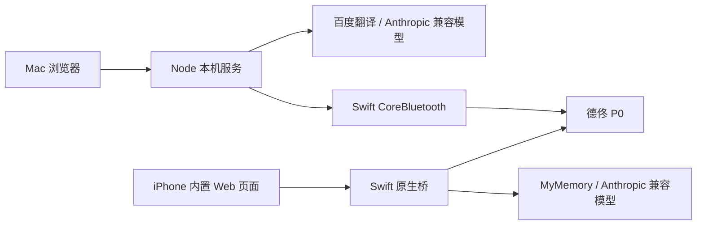

# 开发与排障

[返回项目首页](../README.md) · [使用与配置](usage.md) · [iOS 构建](../ios/README.md)

## 环境与架构

Mac 开发环境使用 Node.js 22+ 和 Swift 工具链；iOS 需要 Xcode、Python 3，以及 iOS 17+ 设备或模拟器。没有数据库、Docker、前端构建或常规运行时 `npm install` 步骤。浏览器依赖已固定在 `web/vendor/`，许可证随代码保留。

Web 由 Node 服务托管，并通过常驻 Swift 子进程控制 Mac 蓝牙；iOS 把同一份 `web/` 打包进 App，通过原生桥直接处理模型、语音、历史和蓝牙，不依赖 Mac 后端。



| 路径 | 职责 |
| --- | --- |
| `web/` | 共享界面、词典、流式解析、卡片、历史和拆分逻辑 |
| `server/` | Mac HTTP 服务、翻译代理、模型配置及设备通道 |
| `printer/` | Swift 蓝牙与栅格渲染、LPAPI 编码、独立诊断 |
| `ios/` | iPhone 工程、Keychain、原生服务与本地诊断 |
| `tests/` | 协议、存储、渲染、模拟设备及浏览器回归 |
| `scripts/` | 服务管理、符号归档、日志采集、模型基准 |
| `.local/`、`work/` | 已忽略的本机配置、诊断、临时数据；不要提交 |

修改前读 [AGENTS.md](../AGENTS.md)；UI 修改还需遵守 [DESIGN.md](../DESIGN.md)。字体等规则通过全局 token 同步，不能只改一个页面。

## 验收服务管理

首次短暂体验用 `./scripts/preview.sh`；需持续运行的本机验收使用独立 tmux 会话：

```sh
node scripts/acceptance.mjs up
node scripts/acceptance.mjs status
node scripts/acceptance.mjs down
```

管理脚本需要 `tmux`、`lsof`，并强制读取 `~/.config/local-deploy/ports.yaml`。`up` 核对登记、监听进程工作目录和 `/api/health` 的 `root`，只复用同工作区健康服务；`down` 只停止它自己管理的会话。

端口分工：10290 为实际 Web/API，10291 为模拟模型，10292 为测试 Web/API，10293 为独立宣传页预览，10294 保留给临时 Lighthouse 检查。项目登记整个 10290–10299 段。先检查现有登记及全部端口占用；不要停止来源不明的进程：

```sh
lsof -nP -iTCP:10290-10299 -sTCP:LISTEN
```

其他开发者使用管理脚本前，可将以下条目**合并**进自己的登记表。把 `/absolute/path/to/english-printer` 替换为本地仓库绝对路径；已有 `projects:` 时只合并其子项，不覆盖原文件或其他项目条目。整个号段须未被其他项目预留或占用。

```yaml
projects:
  english-printer:
    root_paths:
      app: /absolute/path/to/english-printer
    assigned_block: 10290-10299
    docker_compose_project: null
    ports:
      preview:
        port: 10290
        bind: 127.0.0.1
      api-fixture:
        port: 10291
        bind: 127.0.0.1
      api-test:
        port: 10292
        bind: 127.0.0.1
      site-preview:
        port: 10293
        bind: 127.0.0.1
      site-lighthouse:
        port: 10294
        bind: 127.0.0.1
```

当前端口写在服务、管理脚本与测试中；发生冲突时需统一调整并同步登记，不能只改一个启动参数。启动后可用 `curl http://127.0.0.1:10290/api/health` 核对项目与工作区。交付环境需跨工具调用仍然健康，不能把临时前台进程当成长期验收入口。

## 自动化与浏览器回归

从仓库根目录执行；`work/` 在新 clone 中不存在，先创建：

```sh
mkdir -p work
node --test tests/*.test.mjs
```

测试包含实际 Swift 栅格渲染，因此需要 macOS 与 Swift。设备和模型使用模拟对象及假 Key，不打印纸张、不调用付费模型。测试临时占用 10291/10292，不要与下面的模拟服务同时运行。

浏览器模拟环境单独启动，保留该终端；结束后按 `Ctrl+C`，脚本会清理临时配置和测试服务：

```sh
mkdir -p work
node tests/acceptance.mjs
```

打开 [http://127.0.0.1:10292/](http://127.0.0.1:10292/)。此环境模拟模型、翻译与打印设备，不连接蓝牙；它不是实物验收入口。需要固定长词组选项时，以 `P0_OPTION_FIXTURE=1 node tests/acceptance.mjs` 启动替代上面的命令。

浏览器脚本需要可解析的 Playwright 模块和 Google Chrome。没有本地依赖时，可以将 Playwright 安装到被忽略的专用目录，再指定模块位置：

```sh
npm install --prefix .local/browser-test-tools playwright
export PLAYWRIGHT_MODULE="$PWD/.local/browser-test-tools/node_modules/playwright"
node tests/history.browser.cjs
node tests/option-batch.browser.cjs
node tests/split-cards.browser.cjs
node tests/direct-choice.browser.cjs
node tests/effort-settings.browser.cjs
```

以上脚本使用 10292 模拟环境。`tests/settings.browser.cjs`、`tests/keyboard-done.browser.cjs` 使用 10290，修改本机浏览器测试上下文中的设置；运行前确认目标工作区。按改动选取相关回归，不把真实模型或实际出纸混进自动化检查。

UI 回归必须覆盖 390 × 844、390 × 664 下打印、聊天和两个设置分组的字体一致性、内部滚动、溢出、焦点及相关空白/加载/禁用/错误状态；触摸、软键盘和边缘返回仍需真机验证。模拟设备的“已打印”不能作为真实纸面结果。

宣传页使用独立服务与浏览器回归，不需要模拟模型或打印机：

```sh
node scripts/site-acceptance.mjs up
node tests/site.browser.cjs
```

同样通过 `PLAYWRIGHT_MODULE` 指定 Playwright。检查响应式深浅色、资源、键盘、FAQ、标签预览与语音降级；语音测试使用浏览器内注入的模拟接口，不代替实际听音。预览与发布方式见[产品宣传页文档](site.md)。

## 必须保留的行为约束

- 模型 Markdown 先清洗再写入 DOM；工具事件独立解析，流中断或参数不完整时不能生成可打印卡片。
- AI 只创建确认卡片。单张与拆分批次都由可信用户点击触发；批次上一张完成才发送下一张，失败或不确定时立即停止。
- AI 卡片与子 UUID 在下发前持久锁定；保存失败不得发送。历史恢复不能自动续打、解锁或丢掉消费状态。
- 设备请求按 UUID 持久防重。日志、重启和错误处理都不能触发自动补打。
- 主页面音标须对应完整英文；未知词不拼出部分结果。词组统一空格分隔、整段一对斜杠，兼容旧分号输入。
- 历史保存结构化数据，恢复时重新清洗；读取失败不能用空历史覆盖。照片和用户内容不得进入诊断日志。

## 诊断与 iOS 符号

Mac 服务日志位于 `.local/diagnostics/server/`。iOS 本地日志、采集前提与容量限制见 [iOS 诊断文档](../ios/README.md)。两端使用请求 UUID、阶段、耗时和状态码定位问题，不记录用户内容、密钥或完整异常文本，不自动上传。

原生详细诊断由构建配置决定：开发用 **Debug**，发布用 **Release**；不能通过手动开关在生产启用详细日志。每次构建、安装后说明实际配置，并保留匹配产物的符号：

```sh
node scripts/archive-ios-symbols.mjs Debug
# 使用 Release 产物时：
node scripts/archive-ios-symbols.mjs Release
```

手机配对、解锁、信任 Mac 并运行过该版本后，可按设备列表中的 ID 采集：

```sh
xcrun devicectl list devices
node scripts/collect-ios-logs.mjs DEVICE_ID
```

只采集当前 App 的诊断目录，输出到 `.local/diagnostics/ios/`，不导出整个沙盒、聊天或 Keychain。系统报告可能延迟，强杀可能丢失日志尾部；“上次会话未关闭”不能单独证明崩溃。安装成功、进程启动、首屏可用、真机交互与实际纸面须分别确认。

## 付费模型基准

这是显式调用真实模型的实验入口，**不属于自动测试**。需要已保存的 `glm-5.3-flash` 配置；运行前确认允许产生模型费用：

```sh
node scripts/benchmark-model.mjs --run
```

脚本用三个固定合成问题（用法解释、标签卡片、标签选项），比较默认参数与 `output_config.effort=low`。每档重复两次，第二轮反转顺序，计划共 12 次请求；每次最多 2048 输出 tokens，记录首段正文、工具、总耗时及协议校验。鉴权、额度或不支持参数等指定错误会提前停止，不自动重试。不会连接打印设备。

结果与合成回复保存到 `.local/benchmarks/`，不保存 Key、原始思考或真实聊天。默认档表示不传 `output_config.effort`，不等同于 `high` 或 `max`，也不读取设置界面的档位来替代实验分组。

这是小样本 Mac 网络实验，不能排除网络和服务波动，也不能代表手机、图片或长上下文延迟。先前实验中 `low` 曾给出 `infuser` 的错误重音；本地词典缺少该词，未自动纠正。协议及工具结构通过不等于音标正确，需同时检查回答质量，不应将速度差异写成产品保证。
